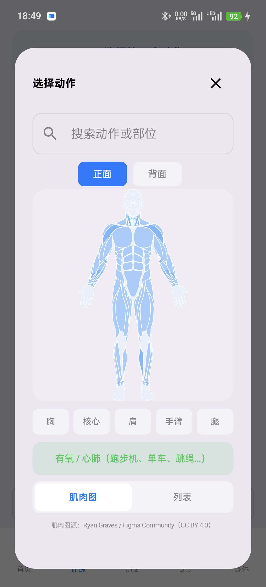
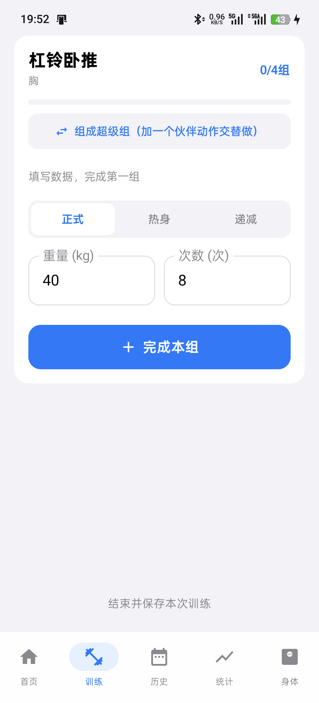
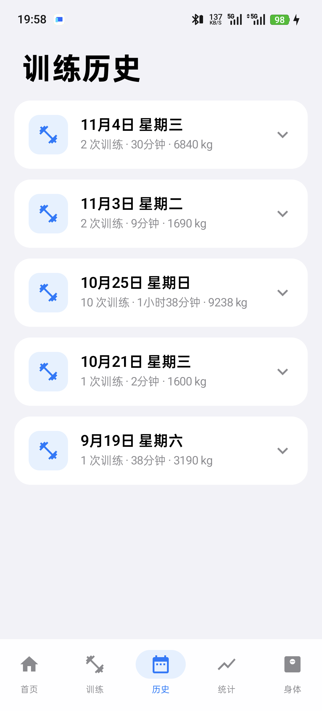
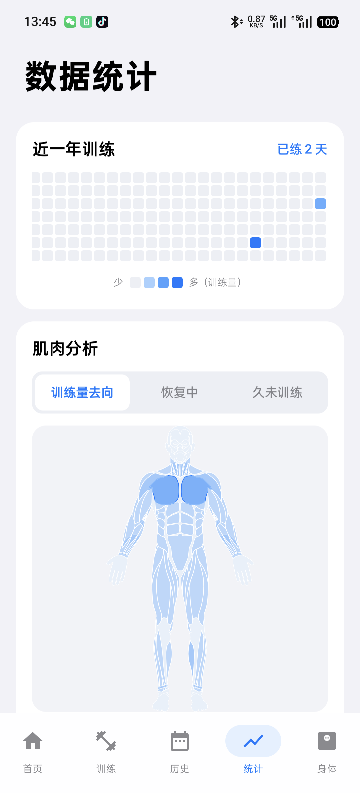
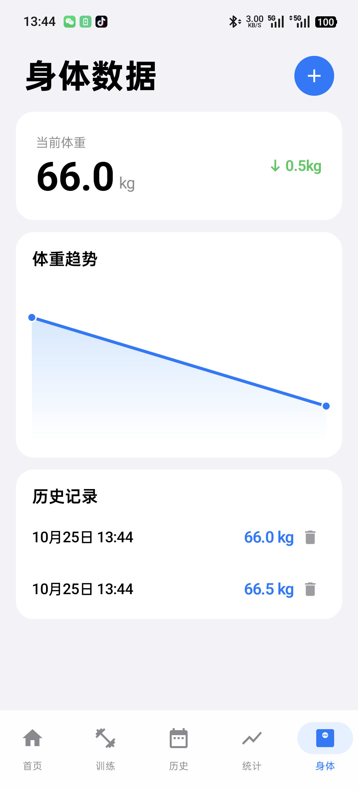

# 撸铁日志 LutieLog

一款**纯本地、不联网、无广告**的安卓力量训练记录 App。用数据量化每一次训练，让进步看得见。

- 平台：Android（minSdk 26 / targetSdk 37）
- 当前版本：v2.7
- 语言：Kotlin + Jetpack Compose
- 数据全部保存在本机，无需注册登录，不收集任何个人信息

---

## 应用简介

「撸铁日志」面向有固定力量训练习惯的健身者，解决一个核心问题：**把每一次训练的重量、次数、组间休息、动作编排系统地记录下来，并据此分析训练量与进步趋势。**

相比商业健身 App，它没有订阅、没有广告、没有信息流推送，也不要求联网授权；打开即练、练完即存，界面采用克制的 iOS 风格设计。

## 目标人群

- 有规律力量训练（健身房「撸铁」）习惯、希望量化训练的健身爱好者
- 关注 1RM、总训练量、肌肉分布、体重变化等指标的进阶训练者
- 反感商业 App 广告与订阅、偏好本地隐私优先工具的用户
- 目前为个人开发者自用项目，界面与文案面向中文用户

---

## 应用截图

<table>
  <tr>
    <td align="center"><b>首页</b></td>
    <td align="center"><b>肌肉图选动作</b></td>
    <td align="center"><b>训练录入</b></td>
  </tr>
  <tr>
    <td></td>
    <td></td>
    <td></td>
  </tr>
</table>

<table>
  <tr>
    <td align="center"><b>训练历史</b></td>
    <td align="center"><b>数据统计</b></td>
    <td align="center"><b>身体数据</b></td>
  </tr>
  <tr>
    <td></td>
    <td></td>
    <td></td>
  </tr>
</table>

---

## 核心功能

**动作选择**
- 内置 **193 个动作**，覆盖胸、背、腿、肩、手臂、核心、有氧七大分类
- 三种选动作方式并存：肌肉图点选（正面 / 背面人形）、列表分组、关键词搜索
- 肌肉图下钻：点击人体对应肌群，直接筛选该部位的全部动作

**训练记录**
- 重量、次数自动预填上次记录，减少重复输入
- 组左滑删除（带撤销）、右滑快速复制上一组
- 按动作单独记忆休息时间，内置休息计时器
- 支持特殊组类型：热身组、递减组、超级组（两个动作交替录入）
- 总训练量按「重量 × 次数」汇总并自动排除热身组；有氧独立记录，不污染力量统计

**数据分析**
- 统计页：1RM 估算、近一年训练热力图、肌肉训练量分析
- 身体页：体重记录与趋势曲线
- 历史页：训练按天分组，可展开查看动作明细，支持会话级删除
- 内置全局崩溃日志收集，异常信息落地本机便于排查

---

## 技术栈

- **Kotlin 2.2** + **Jetpack Compose**（BOM 2026.02，Material 3）
- **Room 2.7** 本地数据库，含完整版本迁移（当前数据库版本 8）
- **Navigation Compose** 页面导航，**MVVM** 架构
- **Kotlin Coroutines** 异步处理，**Vico** 图表库
- KSP 注解处理

---

## 构建与运行

推荐使用 Android Studio 打开项目，Gradle 会自动同步并生成本机配置。

命令行构建 Debug 包：

```bash
# Windows
gradlew.bat assembleDebug

# macOS / Linux
./gradlew assembleDebug
```

构建产物路径：

```
app/build/outputs/apk/debug/app-debug.apk
```

> 说明：构建需要 `local.properties` 中的 `sdk.dir` 指向本机 Android SDK，用 Android Studio 打开时会自动生成，该文件不会被提交到仓库。

---

## 未来规划

当前版本为纯单机，以下为规划方向，**尚未开发**：

- **训练社区**：训练打卡动态、好友关注、点赞与评论；实时私聊（IM）将根据使用规模、服务器成本与合规要求再评估是否上线
- **苹果端（iOS）**：在安卓版本功能稳定后，评估跨平台或原生移植
- 历史会话的编辑能力、更多自定义动作管理等体验优化

---

## 数据来源与致谢

- 肌肉解剖矢量图基于 [flutter-body-atlas](https://github.com/kit-g/flutter-body-atlas)（BSD-3-Clause）改编，原始人体作品由 Ryan Graves 创作，依据 CC BY 4.0 许可使用
- 动作库在整理过程中参考了 Everkinetic（CC BY-SA 4.0）、free-exercise-db（Unlicense）等开源健身数据集
- 感谢以上开源项目与作者

---

## 开源协议

本项目目前暂未指定开源协议，代码版权归作者所有。如需协作或二次使用，请先与作者联系。
